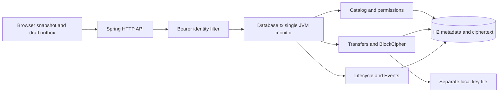
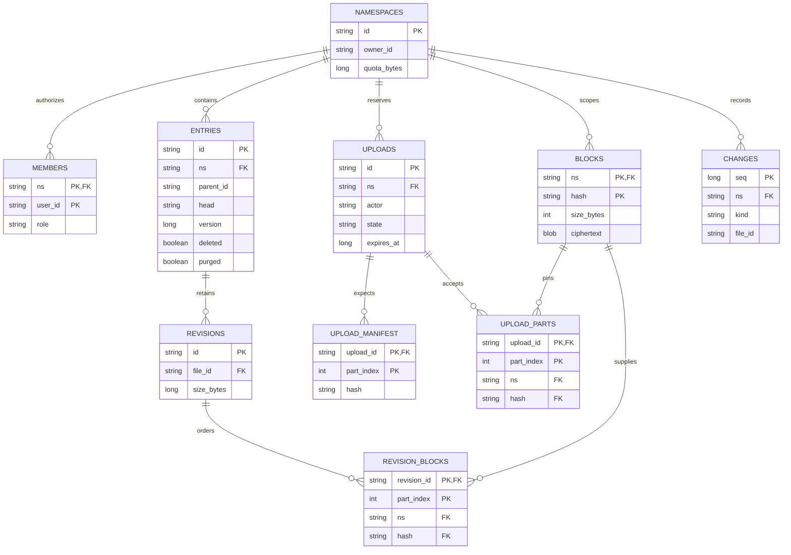

# 2. Components and authoritative data

The [schema](../../backend/src/main/resources/schema.sql) is installed idempotently at startup. JDBC is used directly so the transaction boundary and queries stay visible. [Database.tx](../../backend/src/main/java/dev/commonplace/Database.java) holds one JVM monitor around the full transaction, including commit. [Catalog](../../backend/src/main/java/dev/commonplace/Catalog.java) owns namespace access, folder topology and optimistic metadata versions. [IdentityFilter](../../backend/src/main/java/dev/commonplace/IdentityFilter.java) resolves bearer tokens before API execution.

The modules are ownership boundaries inside one process, not independently deployed services. Controllers choose a transaction; domain classes issue JDBC queries. A scheduled lifecycle task uses the same transaction wrapper as API requests. Static frontend assets are delivered with the local application; they do not own authoritative file state.

## Entity relationships

Solid relationships below represent foreign keys in [schema.sql](../../backend/src/main/resources/schema.sql). The parent and head pointers are intentionally documented separately because the database does not constrain them.

`operations(actor, op_key)` is an independent receipt table; actors are the three configured identities rather than rows in a user directory. `settings` holds the seed marker. A change row's `file_id` is a logical identifier, not an entry foreign key: sharing events use an empty identifier, and deletion events must remain interpretable after the content is gone. `entries.parent_id = ''` means the namespace root. A null head is valid for a folder and for a purged tombstone.

Namespaces own entries and members through database foreign keys. `members(ns,user_id)` is unique and roles have a database CHECK constraint. Entry IDs are primary keys. `entries(ns,parent_id,deleted)` accelerates folder reads. Parent relationships are checked by the application, not a foreign key: the empty string denotes a namespace root. Cycle, sibling-name and cross-namespace validation depend on the single transaction serializer. Moving to several processes without replacing that mechanism would be incorrect.

## What SQL proves, and what it does not

| Invariant | SQL enforcement | Application enforcement and consequence |
| --- | --- | --- |
| One role per namespace/user | Composite membership primary key; allowed-role CHECK | `owner_id` and exactly one owner membership must agree; the sharing API cannot remove the owner |
| A manifest reference points to stored bytes | Composite foreign keys to `(ns, hash)` in `blocks` | References must belong to the upload/revision's namespace, in contiguous order, with declared lengths |
| An accepted part has one index | `(upload_id, part_index)` primary key | Index/hash/size must match the separate expected manifest; no FK joins these two part tables |
| Published content is complete | Revision and manifest foreign keys | `complete` validates count, installs revision/head, and saves its receipt in one transaction |
| Valid folder tree and sibling name | Parent index only; no parent FK or sibling unique constraint | Parent exists, is active folder in same namespace; no cycles; active siblings have case-sensitive distinct names |
| Head belongs to this file | No FK on `entries.head` | Only publication assigns heads; revision download also checks `file_id` |
| Version and quota remain valid | Namespace quota has a nonnegative CHECK | Versions, size/block bounds, retained-byte accounting, and reservations are domain rules |
| Ciphertext matches address | Block key is unique in namespace | SHA-256 validation plus AES-GCM authenticated data and read-time hash verification |
| Retry cannot apply twice | Receipt primary key `(actor, op_key)` | Canonical digest rejects different input, role checks precede replay, transaction persists result with mutation |

This is not a schema that arbitrary SQL writers may safely modify. The supported writer is the domain layer under `Database.tx`. Some rules could become declarative constraints during a production migration; tree cycles, quota sums, and object publication still need a deliberate concurrency protocol. The H2 schema initializer is idempotent startup DDL, not a versioned migration/rollback framework.

`operations(actor,op_key)` stores a canonical request digest and response in the same transaction as each retryable mutation. A different request using an old key yields `409 KEY_REUSED`. The application retains these receipts indefinitely in this lab; production needs a documented retry horizon before pruning them. Access is rechecked before namespace-scoped replay.

Receipt keys are scoped to an actor across endpoints, so clients must generate a fresh key for each new intent. A timeout is not a reason to generate another key for the same request. Upload completion uses its terminal session/result as the receipt instead of requiring a new header.

## Read models and indexes

The snapshot returns all unpurged namespace entries, including trash, joined to current revision size. It also calculates retained logical usage, active reservations, ciphertext payload size, and a cursor in the same transaction. The browser can build folder/search views from that snapshot; no search service is involved. At large namespace sizes, both full snapshots and repeated aggregate sums become scaling issues. Introduce bounded listings and transactionally maintained usage counters only with reconciliation checks.

`changes(ns, seq)` supports ordered catch-up. `uploads(ns, state, expires_at)` supports reservation accounting. Revision history uses `(file_id, created_at)`. These indexes reflect query shapes in the source; their existence does not prove an execution plan or latency target. A performance review should measure cardinalities and inspect plans for the actual production database.

The [foundation test](../../backend/src/test/java/dev/commonplace/FoundationTest.java) checks unauthenticated access, denied namespace reads, stable IDs, idempotent folder creation, request mismatch and folder cycles.

Architectural lesson: make a small workflow correct and persistent before extracting services. A low component count is useful when it makes the ownership and consistency boundary clear. [ADR 0001](../decisions/0001-local-transaction-boundary.md) explains the alternatives and the first trigger for replacing this boundary.
