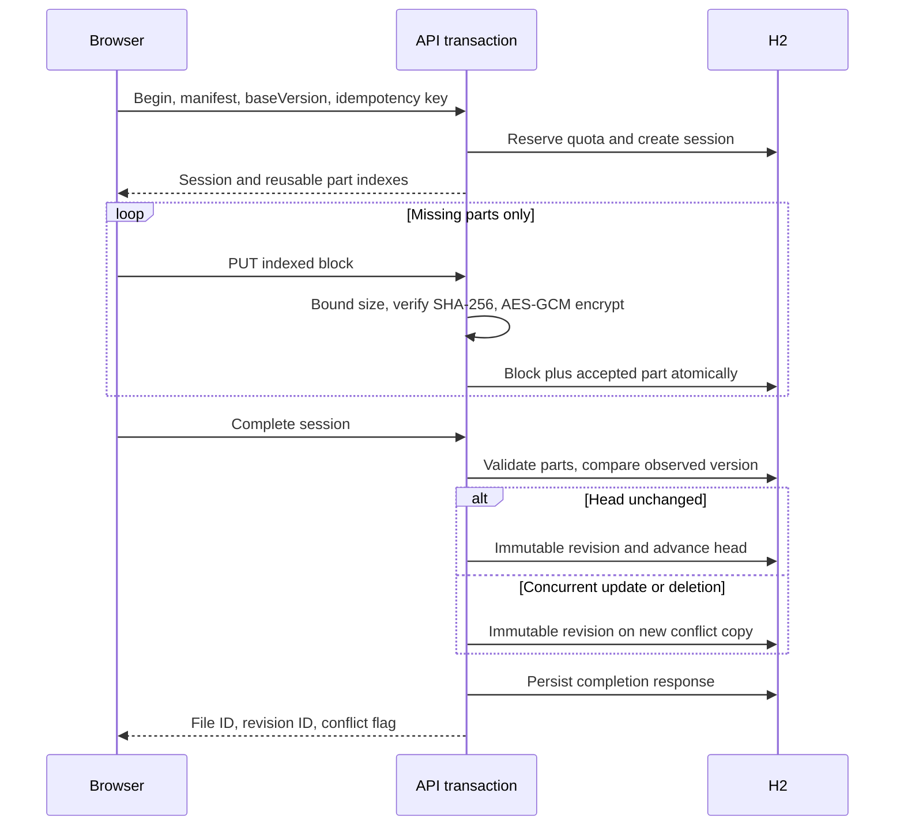
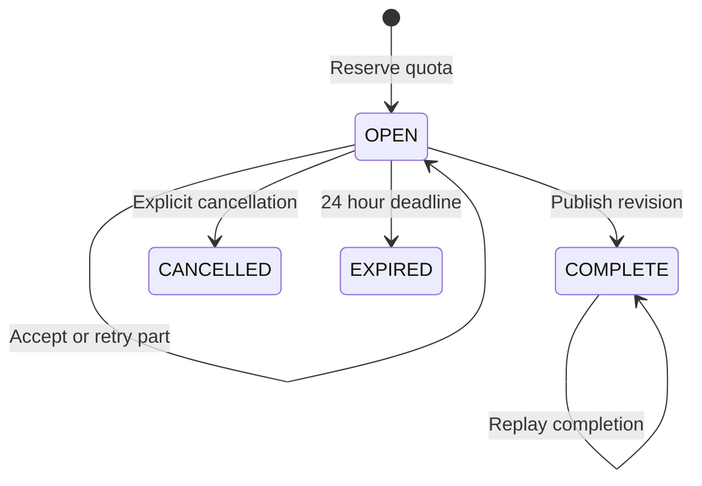
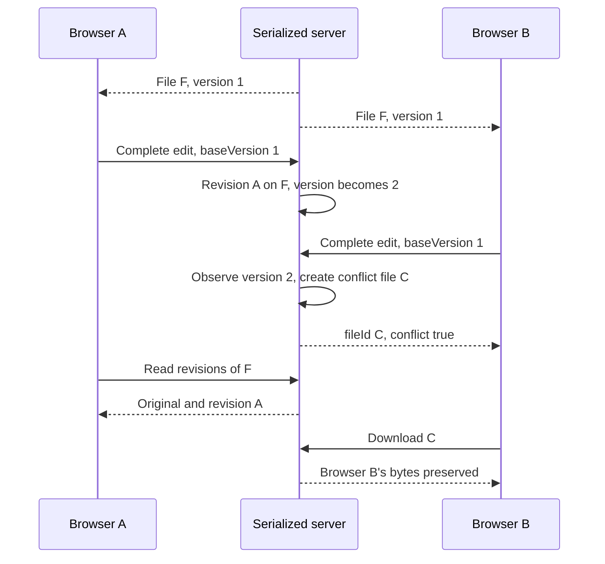
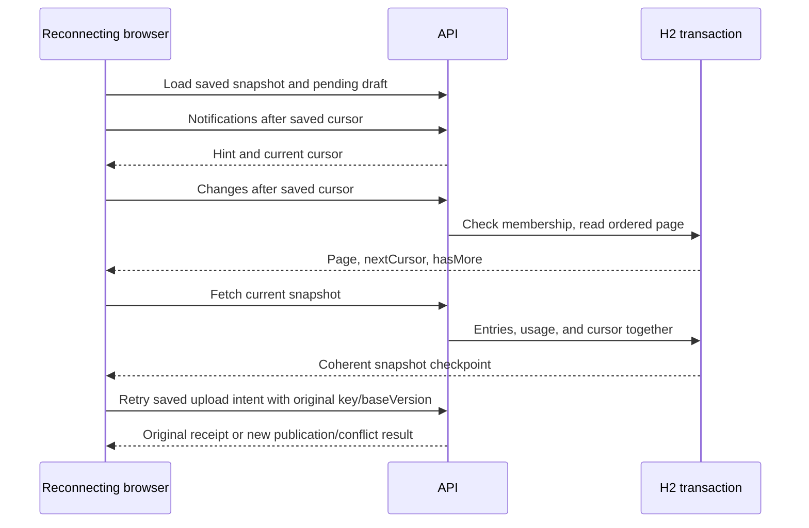
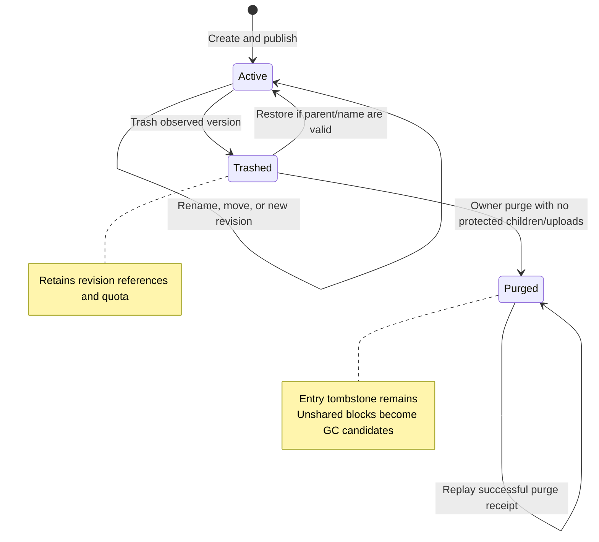

# 3. Transfers, revisions and consistency

[Transfers](../../backend/src/main/java/dev/commonplace/Transfers.java) separates immutable block transport from publishing a file head. A client hashes each fixed 4 MiB slice using SHA-256 and sends a manifest. The server reserves the full logical revision size, reuses matching blocks only inside the authorized namespace, and returns accepted part indexes. `GET /api/uploads/{id}` is authoritative after a timeout; retrying a block does not duplicate it.



## States and failure boundaries



Incomplete uploads are not visible files. A part and its block commit together. Completion validates the manifest, creates the revision and ordered manifest, advances a head, and saves the replayable response in one H2 transaction. A crash before commit leaves the previous state; after commit, status/complete recovers the result. No process needs to guess whether an object-store callback happened.

The server accepts a whole-file manifest before it accepts bytes. Expected hashes are distinct from accepted part references: a manifest says what should arrive; `upload_parts` says which bytes are safely stored. Repeated identical hashes can appear at different indexes. Reuse is a lookup by namespace, hash, and expected size; SHA-256 is an address, not an authorization credential.

| Failure point | Durable state | Recovery |
| --- | --- | --- |
| Begin reply lost after commit | Session, reservation, operation receipt | Retry the exact begin request with the same key |
| Part request interrupted before commit | No accepted index for that transaction | Read status; resend only absent indexes |
| Part reply lost after commit | Block and accepted index | Read status or resend the same indexed bytes |
| Completion finds missing parts | Open session, no visible revision | Send missing parts, complete again |
| Completion reply lost after commit | Revision, new head, change, terminal result | Repeat completion; receive the same file/revision IDs |
| Browser returns after deadline | Reservation no longer counted; session may await cleanup | Start a new session; namespace blocks may still be reusable |

The 24-hour deadline is absolute. `GET` status can still show `OPEN` after its time has elapsed until cleanup marks it `EXPIRED`; write methods check both row state and deadline. Session expiry is therefore a semantic deadline, not a promise that a scheduler ran at that millisecond.

A file's metadata version increments on both content and metadata changes. Stale content completion creates a conflict file at the namespace root; it never overwrites the newer head. Metadata operations return `409 STALE_VERSION` for explicit refresh/retry. A new-name race also preserves the later upload as a conflict. A folder trashed while an upload is active causes recovery at root.



This policy compares one observed counter rather than timestamps or vector clocks. It detects that something changed; it does not classify which fields changed or merge independent edits. A rename also advances the counter and can cause a content conflict. That is conservative and visible. Choosing automatic merge would require a richer file-format-specific contract; last-writer-wins would discard acknowledged work. See [ADR 0003](../decisions/0003-conflicts-and-change-recovery.md).

## Byte and quota accounting

Maximum size is exactly 10,000,000,000 bytes. Blocks are 4,194,304 bytes except the last. Empty files have an empty manifest. The server bounds raw request reads at block size + 1 and JSON at 1 MiB, including bodies without a declared length. The client never needs an entire large file in memory for hashing or upload. Upload sessions expire after 24 hours without extending on activity. Retained revision logical bytes + active reservations must fit quota. Completion converts a reservation into retained bytes; duplicate blocks save physical storage, not logical quota.

[BlockCipher](../../backend/src/main/java/dev/commonplace/BlockCipher.java) uses AES-256-GCM, a fresh 12-byte random nonce, a 128-bit authentication tag, and namespace/hash authenticated data. Stored overhead is 28 bytes per distinct block before database overhead. Metadata is plaintext. This is server-side encryption, not end-to-end encryption. The local key is a separate 32-byte file; losing it means losing readable content. Existing ciphertext prevents silent replacement of a missing key.

## Download

The server checks current namespace access and confirms that the requested revision belongs to the stable file ID. It reads, authenticates and writes one block at a time, in manifest order. The local serializer is held through streaming so purge cannot race an active reader. This severely limits concurrency, especially with slow clients; production needs reader leases/object retention instead of holding this lock. A midstream integrity error aborts the response rather than returning fabricated bytes.

## Runnable contract

```bash
curl -H 'Authorization: Bearer local-alice-key' http://127.0.0.1:8080/api/namespaces
```

Upload creation: `POST /api/uploads`, bearer token, `Idempotency-Key`, JSON:

```json
{"ns":"namespace-id","parentId":"","name":"empty.txt","size":0,"hashes":[],"baseVersion":0}
```

For replacement add `fileId` and the observed `baseVersion`. Transfer blocks with `PUT /api/uploads/{id}/parts/{index}` using `application/octet-stream`. Complete with `POST /api/uploads/{id}/complete`. `GET /api/entries/{id}/revisions` lists immutable revisions; `GET /api/entries/{id}/download?revision={revisionId}` streams one. Structured errors include `413 FILE_TOO_LARGE`, `422 BLOCK_MISMATCH`, `409 MISSING_PARTS`, `409 QUOTA_EXCEEDED`, `410 UPLOAD_CLOSED` and `403 READ_ONLY`.

[TransferTest](../../backend/src/test/java/dev/commonplace/TransferTest.java) exercises interruption, bad blocks, retries, encryption, reuse isolation, quota and stale edits. The 10 GB limit is a design input; declaring a 10 GB manifest is not proof that a full 10 GB transfer has been measured.

## Changes, notifications and reconnect

Every successful catalog mutation, sharing change and published revision appends a row to `changes` in the same transaction. The global sequence is monotonic in this single serializer; gaps are legal. `GET /api/namespaces/{ns}/changes?after=0` returns up to 100 events, a `nextCursor`, and `hasMore`. Pages advance only to the last returned event. A snapshot contains its cursor from the same transaction, so clients cannot miss a concurrent write between snapshot and checkpoint.

Events contain a kind and stable entry identifier, not the full historical row or content delta. They indicate that a client should refresh authoritative state; they are not an event-sourced reconstruction log. The browser can replace its cached snapshot and adopt that snapshot's cursor. A client that processes feed pages separately must finish each page before persisting `nextCursor`, never checkpoint the notification high-water mark before fetching the intervening changes.



`GET /api/namespaces/{ns}/notifications?after={cursor}` returns a changed hint and current high water mark. This local implementation polls; it does not run WebSockets, mobile push or per-device server queues. Events remain durably queryable after disconnect and restart. Notification loss is harmless because the feed/snapshot remains authoritative. Production can replace the hint transport without changing recovery semantics.

Changes are retained indefinitely in the lab. A production retention horizon requires an explicit `410 CURSOR_EXPIRED` response and snapshot resync. If a backup restore moves the high-water mark behind a browser cursor, the feed returns `409 CURSOR_AHEAD`; reconnect replaces the cached snapshot. Membership is checked on every feed, notification, revision and download call. Revocation cannot erase copies a user already downloaded.

`CURSOR_AHEAD` catches one restore symptom, not every restore. After enough new writes, an old sequence can fall below the restored server's current maximum while referring to a different history. Production should use a recovery epoch in cursor/snapshot tokens and invalidate pre-restore receipts or reconcile them under a documented policy. The [restore lab](06-build-and-architecture-labs.md) deliberately exercises the simpler detectable case before new writes advance the cursor.

## Deletion, retention and safe collection

Trash is reversible and increments the metadata version. Folders must have no active children before trashing; there is no hidden recursive delete. Restore checks the current parent and sibling name. All revisions of a trashed file remain downloadable to current namespace members and continue consuming quota.

Only an owner can permanently purge a trashed entry. Purge removes all of its revision manifests and revisions; an entry tombstone and mutation receipt remain so retries cannot apply twice. The tombstone still retains metadata such as name, parent, namespace, and version; this is content purge rather than a claim of complete metadata erasure. Purged entries disappear from snapshots. Purge refuses folders with unpurged children and entries with active uploads targeting the file or parent. Resolve or cancel those uploads first.



`POST /api/namespaces/{ns}/gc` performs an owner-only, at-most-100-block collection batch. It first expires elapsed sessions and drops closed-session part references in bounded batches. It deletes a block only when no revision manifest and no upload-part reference exists. A foreign key is a second line of defense. Collection, upload registration, publication and streamed readers share the same transaction serializer. There is no mark/sweep race in this process; distributed object storage needs a grace period plus leases/generation checks. Unreferenced physical bytes can remain until manual GC; this is safe space leakage rather than premature deletion.

A scheduler performs session cleanup every minute, at most 100 expired sessions and 100 closed-session part sets per run. Expiration releases quota logically at the deadline even before cleanup. Terminal upload receipts, metadata tombstones and changes are retained; they need a documented retention policy at production scale.

The collector's root set is revision manifests plus accepted upload parts. An expected hash in `upload_manifest` alone does not pin a block: no accepted part exists until bytes are present or authorized reuse has been registered. Closed uploads lose their temporary pins during cleanup; completed revisions keep their own references. This distinction lets an interrupted upload share existing bytes safely without retaining every declared hash forever.

[SyncTest](../../backend/src/test/java/dev/commonplace/SyncTest.java) covers reader denial, revocation, durable cursor behavior, retained revisions, reference-safe GC, expired uploads and edits completed after trash.

[HardeningTest](../../backend/src/test/java/dev/commonplace/HardeningTest.java) adds real simultaneous completion requests, out-of-order multi-block streaming, feed page boundaries with sequence gaps, revoked receipt/session access, and purge replay. [RecoveryTest](../../backend/src/test/java/dev/commonplace/RecoveryTest.java) closes and reopens file-backed application contexts to verify partial-upload resume, immutable content, operation results, and changes; it also checks missing/corrupt/truncated key refusal and recovery with the matching key. Reopened contexts exercise persistence, while the manual lab adds a server stop/start and a cold-copy rollback. None of these is a power-loss durability certification or a measured 10 GB transfer.
