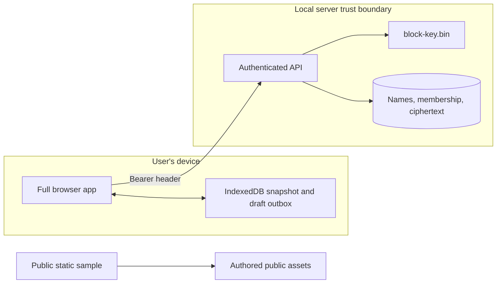

# 4. Security and delivery boundaries

## Implemented local trust model

Three configured bearer tokens map to the teaching identities Alice, Bob and Eve. The public defaults are convenient credentials, not a secure login system. The server binds `127.0.0.1`. Set all tokens to independent random values before changing that boundary. Do not expose the local server to the internet; it lacks TLS termination, account enrollment, rate limits and a managed key service. It has no Google dependency.

The [identity filter](../../backend/src/main/java/dev/commonplace/IdentityFilter.java) applies to every API route except health. Tokens travel in the Authorization header, never download URLs. Responses are `no-store`; CORS is not enabled. Browser-origin requests cannot use ambient cookie credentials because there are none. JSON reads are bounded, and block requests have a separate bound. Content downloads use `application/octet-stream`, `Content-Disposition: attachment` and `nosniff`; user HTML/SVG does not execute as the application origin.

Namespace membership is the authorization boundary. Owners manage sharing and permanent purge; writers mutate content and folders; readers list and download. Sharing is namespace-wide, not individual files or inherited per-folder ACLs. [Catalog](../../backend/src/main/java/dev/commonplace/Catalog.java) enforces it server-side, including before returning cached idempotency results. Upload sessions additionally belong to their initiating user. An owner cannot inspect another user's pending session through its ID.

Payloads are AES-GCM encrypted before persistence. Namespace/hash authenticated data detects relocation or corruption. The key is kept outside the database and created with owner-only POSIX permissions where supported. Metadata, names, sizes and membership are plaintext; the OS account and database remain trusted. Encryption at rest does not protect a compromised running server. No compression, cross-namespace deduplication, malware scanner or end-to-end key management is implemented.

## Honest delivery modes

The full local application owns persistent metadata, encrypted blocks, resumable uploads, access enforcement, change polling and browser synchronization. The separate React static build contains only explicitly authored public sample content. GitHub Pages cannot run Spring, H2 or a scheduler. Static mode offers sample browsing, search, downloads and revision inspection while directing state-changing workflows to the local application. It is not a proxy to a running private server.

Browser storage belongs to its browser origin/profile. It can help recover a draft after reload, but clearing site data or browser eviction can remove it. Two tabs sharing an origin/profile are not independent device-storage experiments; use separate browser contexts/profiles for the reconnect lab. Large file bytes are not all retained in the outbox; reselect the file to verify its size/hash manifest before resuming missing indexes. There is no background operating-system file watcher.

The repository contains [browser transfer code](../../frontend/src/client.ts) and [IndexedDB storage](../../frontend/src/storage.ts). Browser assertions must be verified with the frontend checks in [the labs](06-build-and-architecture-labs.md); backend integration tests alone do not establish offline UI behavior. The browser's save-to-disk capability also varies: streaming to a selected file uses the File System Access API where available; the fallback buffers bounded downloads. The API itself streams blocks and is usable with `curl` for larger downloads.

## Follow the trust decision through the request

| Surface | Current control | Remaining boundary |
| --- | --- | --- |
| Namespace ID or entry UUID | Resolve entry, check membership in its namespace | UUID secrecy grants no access; metadata existence may be distinguishable from access denial |
| Upload session ID | Check initiating actor plus current writer/owner membership | Revoked/downgraded actors cannot finish an old upload |
| Replayed idempotent request | Check namespace role before returning a stored result | Receipts are not transferable bearer capabilities |
| Block hash | Reuse lookup remains inside authorized namespace | No global “does this hash exist?” endpoint |
| Stored ciphertext | AES-GCM with namespace/hash as authenticated data | Running server and local key holder can decrypt |
| Downloaded bytes | Attachment response, binary content type, `nosniff` | Downloaded files can still be opened by another program |
| Public sample build | Authored sample assets only | Every shipped asset is public; no private database export belongs in the build |

The key file and database share a filesystem directory in the default setup, though they are separate artifacts. This helps backups include both; it does not isolate them from the same OS account or stolen volume. The cipher checks one stored block at startup as a key compatibility check, then authenticates every block when read. Startup is not a full integrity scrub.

Production identity would replace static tokens with enrollment, token lifetime/revocation, TLS, request limits, and an audited authorization policy. Production key management would need envelope encryption, key identifiers, rotation, backup/restore drills, and a separate administrative trust boundary. Those mechanisms are proposals, not features implied by the local AES implementation. [ADR 0004](../decisions/0004-namespace-security-and-delivery.md) records why this workshop keeps those boundaries small.

## Decision record: authorization scope

Requirement → understandable, testable sharing. Mechanism → one membership table per namespace, role checks on every API. Tradeoff → no item-level permission exceptions. Evidence → HTTP integration tests deny reader writes and revoked reads. Revisit → users need mixed private/public subtrees inside one namespace; introduce explicit inheritance rules and evaluate every query/download against them before changing UI controls.

Browser reads pin the displayed immutable head before fetching bytes, so a concurrent replacement cannot silently enlarge a preview or change a selected download. Preview/editor reads have explicit bounds; fallback downloads are limited to 64 MiB. Larger browser downloads open a File System Access save picker during the click before awaiting network headers, then pipe the response to disk. Saved drafts are listed across the current user's namespaces: an inaccessible or expired operation cannot block another namespace, and it remains exportable or locally discardable. Active transfers must finish or fail before their outbox session can be discarded.
