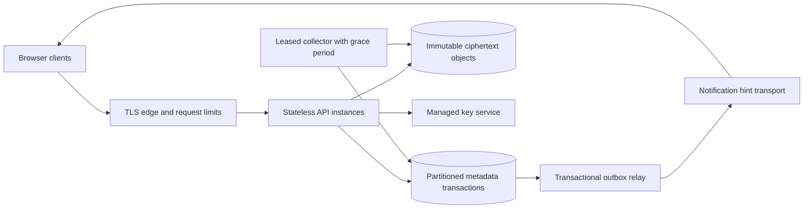

# 5. Scaling and operating the design

The local system has one Spring process and one file-backed H2 database. `Database.tx` serializes the whole transaction, including commit. Downloads retain that monitor while they authenticate and stream blocks. A slow consumer therefore delays unrelated metadata calls, lifecycle cleanup, and other downloads. The Hikari pool size does not remove this application lock. This is the first architectural bottleneck to test, not a reason to claim an unmeasured requests-per-second limit.

## An evidence-led production path

| Pressure or requirement | Proposed next mechanism | Guarantee that must survive | Evidence needed before switching |
| --- | --- | --- | --- |
| Slow downloads delay metadata | Store immutable ciphertext objects outside metadata DB; give readers short-lived authorized access or leases | Published revision always resolves to durable verified bytes; purge cannot remove active-reader objects | Slow-client test, publish-failure tests, reference/lease race tests |
| Several API instances | Production relational DB; namespace-scoped locks/CAS and unique constraints | Quota reservation, names, versions, receipt, and change append commit coherently | Cross-process concurrent upload/rename/quota tests against target DB |
| Snapshot or quota query cost grows | Paginated listings, maintained usage counters, periodic reconciliation | No skipped entry during resync; counters equal retained revisions plus live reservations | Large-namespace query plans, restart and reconciliation tests |
| Many polling clients | WebSocket/SSE/push hints backed by durable feed | Missed/duplicate hints never lose changes | Disconnect, reconnect, backpressure and dropped-message tests |
| Feed/receipt/tombstone growth | Documented retry and history horizons; cursor expiry, recovery epoch | Offline clients cannot replay pruned history as new intent silently | Long-offline resync and restore-epoch tests |
| One region is insufficient | Defined primary/replica policy and tested failover | Acknowledgment meaning and conflict ownership remain explicit | Measured replication lag, regional failure exercise, recovery reconciliation |

Extract a payload path before inventing a service for every domain noun. A namespace is a useful candidate for metadata partitioning because membership, topology, quota, and changes are already scoped to it. A very large shared namespace can still be a hot partition. Hashing requests across servers does not divide a namespace transaction safely.

This diagram is a proposal. The repository does not deploy these components. Its API response cannot become “successful” merely because an upload was queued; the product must define whether acknowledgment means bytes durable, manifest published, or work scheduled.

## Replacing the local atomic boundary

Today metadata and ciphertext commit in one database. Moving blocks to an object store creates a dual-write boundary. A plausible publication protocol is:

1. Reserve logical quota and establish an upload manifest in a metadata transaction with its idempotency receipt.
2. Write immutable staged objects; verify checksums/length and the object store's required durability acknowledgment. Register accepted parts with generation-aware metadata references.
3. In one metadata transaction, check membership, session expiry and observed version; install immutable revision/manifest, update head or conflict copy, consume reservation, persist terminal result, and append an outbox change.
4. Relay notification hints at least once. Consumers deduplicate or refetch; durable feed rows remain the recovery source.
5. Remove abandoned objects only after a grace period and reference/lease checks. If the process crashes after object write but before metadata registration, the result is an orphan candidate, not permission to collect an object another publisher has just referenced.

No distributed transaction with the browser is required. Idempotency and inspectable session state still resolve ambiguous replies. Objects must be immutable under their address, and the store's overwrite/read/list behavior must be verified. A cache cannot replace the revision's authoritative manifest. A collector must tolerate delayed listing and competing writers according to that store's actual contract.

## Proposed SLOs and measurement

These are proposed targets for a future regional service, not measurements of this lab. Define a workload envelope before accepting them: active namespaces, metadata cardinality, upload/download size distribution, simultaneous slow transfers, client RTT, and the intended peak from chapter 1.

| Indicator | Proposed target and denominator | How to observe it |
| --- | --- | --- |
| Metadata availability | At least 99.9% successful eligible metadata requests per rolling 30 days | Count server/network failures and timeouts; exclude intentional 4xx validation/access responses from eligibility, report them separately |
| Metadata read latency | p95 below 200 ms at server boundary under the agreed regional load | Histogram from request acceptance to completed response, with endpoint and outcome dimensions |
| Online change visibility | p95 below 2 s for connected, authorized clients within a specified RTT envelope | Synthetic browser writes a uniquely tagged change and measures until another context displays refreshed state |
| Revision integrity | Every checked download matches its manifest | Count authentication/hash failures; periodic sampled/full verification with recorded coverage |

Request-based 99.9% is an error budget of 0.1% of eligible requests. Its time-based analogue is 43.2 minutes in 30 days, but a request SLI must not silently become an uptime percentage. A low-volume outage can have different request and time impact. Online visibility excludes intentionally offline clients; track reconnect catch-up duration separately so that exclusion does not hide a poor recovery experience.

The local `/api/health` returns that a handler is reachable. It is not a disk-space check, full decryption check, restore proof, or SLO dashboard. Custom production metrics/tracing and an SLO evaluator are not implemented here.

Useful instrumentation would include transaction wait and hold histograms, active transfers, bytes by upload state, oldest overdue session, cleanup backlog, GC candidates/collection counts, feed page depth, conflict frequency, quota denials, key/authentication failures, and filesystem free space. Correlate a request ID, opaque namespace ID, upload ID and operation key without logging bearer tokens, plaintext content, key material, or raw filenames. Separate high-cardinality identifiers into traces/logs rather than metric labels.

## Runbooks tied to the mechanisms

| Symptom | First checks | Safe response | Follow-up evidence |
| --- | --- | --- | --- |
| Metadata latency rises during downloads | Compare transaction wait/hold time with transfer duration and slow client connections | Pause the test load or end the identified slow transfer; preserve resumable session state | Repeat the same workload after payload-path change; report tail latency and throughput together |
| Namespace reports full despite few visible files | Inspect `usedBytes`, `reservedBytes`, trash and revision history | Cancel known abandoned sessions or have owner purge intentionally discarded trash; run bounded GC for physical space | Confirm logical usage changed for the intended reason; GC alone does not reduce retained quota |
| Disk grows after purges | Distinguish referenced block payload, unreferenced blocks, and H2 file allocation | Run owner GC batches until zero candidates; follow the database's supported offline maintenance procedure if reclaiming file allocation is needed | Record rows/payload removed separately from filesystem size; row deletion need not shrink the DB file |
| Upload is closed after reconnect | Compare status state and absolute `expiresAt` | Start a new intent/session and reselect bytes; retry available namespace blocks | Ensure abandoned reservation no longer counts and cleanup is progressing |
| Decryption fails or key is missing | Preserve DB/key artifacts; inspect startup/read failure, verify backup provenance | Stop writes; restore a verified matching DB/key pair into an isolated directory | Verify all required revisions, not only startup's first-block check |
| Cursor is ahead after recovery | Compare browser cursor with restored namespace cursor | Fetch fresh snapshot; keep pending drafts for explicit retry/reconciliation | Record recovery point and any acknowledged writes after it; add recovery epochs before production |
| Revoked browser shows old content | Verify server request is denied, then distinguish cached/downloaded copies | Stop retries requiring revoked access; communicate local cache behavior | Test server denial with a separate context; revocation cannot retract offline copies |

The cleanup scheduler marks at most 100 elapsed sessions and drops at most 100 closed-session part sets per minute. A large backlog can take many passes. Quota excludes elapsed reservations immediately, even if the cleanup row state lags. GC itself is owner-triggered and collects at most 100 blocks per request; scheduling automatic object reclamation would be additional work.

## Backup, restore, RPO, and RTO

The durable unit is the H2 database **and its matching `block-key.bin`**. The default root launch stores them under `./data`; `DRIVE_DATA` chooses another directory. The in-memory key survives file deletion until restart, so a running process is not proof that the on-disk backup key exists. Static build files and a browser cache are not server backups.

The lab supports a simple cold-backup procedure: stop the application, confirm its process has exited, copy/archive the complete data directory with file permissions preserved, record a timestamp and checksums, then restart. Keep a second protected copy outside the working data directory. Do not copy an actively changing H2 file and call it a consistent backup; online backup requires a supported database procedure and separate validation. Retain the key with each backup generation and document who can retrieve both.

Proposed production recovery objectives are **RPO ≤15 minutes** and **RTO ≤60 minutes** for a regional metadata/storage failure. RPO is the maximum acknowledged-write interval that may be absent after recovery; RTO is time from declared incident to verified usable service. Neither target is established by a local cold copy. Meeting them requires an automated backup/log/replication schedule, independent failure domains, matching key availability, alerts, capacity to restore, and measured drills. Replication also replicates accidental deletion; retain recoverable historical backups.

A restore drill must select a backup, restore into a fresh data directory, start with the same key, verify identity/membership, enumerate revisions, download and hash representative or all required content, test feed recovery, and record start/end times plus the newest included acknowledged mutation. Do not test by overwriting the only live directory. Chapter 6 gives a local drill. If a restore loses mutations after the backup, report that loss; a retry receipt restored from the same point cannot recreate absent user intent by itself.

## Architecture review exercise

Propose two application instances behind a load balancer. For each of sibling naming, quota reservation, head comparison, receipt replay, feed ordering, and purge-versus-reader safety, name the SQL constraint or concurrency protocol replacing the JVM monitor. Then inject a crash between each object and metadata write. A proposal that answers only “use Postgres and S3” has named products without specifying the protocol.
